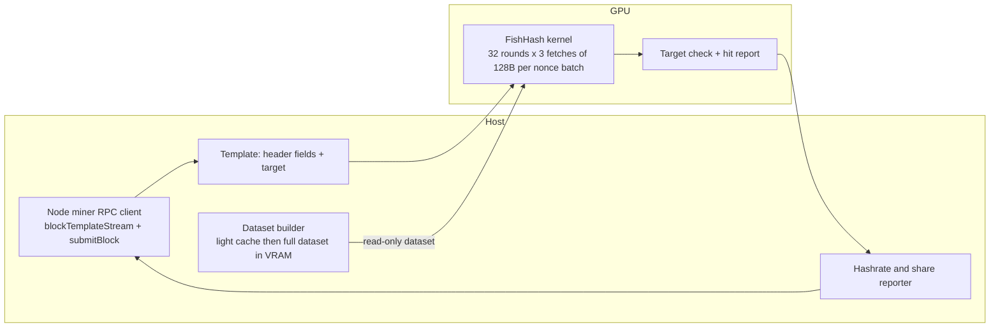

# FishHash CUDA Miner POC - Plan

## Goal Capsule

**Objective.** A working proof-of-concept Iron Fish (FishHash) miner that connects to an Iron Fish full node via its miner RPC and submits blocks the node accepts, on RTX 40-series and 50-series GPUs, with measured hashrate against the memory-bandwidth ceiling. Phase 1 = correctness plus end-to-end mining; Phase 2 = efficiency tuning toward at least 65% of peak bandwidth utilization (about 53 MH/s on a 4090).

**Means.** Own CUDA C++ implementation following SRBMiner-Multi's architecture (CLI shape, node-RPC flow, dataset in VRAM), with the official fish-hash reference as byte-exact oracle (KTD1, KTD2).

**Authority hierarchy.** User directives > plan KTDs > unit details.

**Stop conditions / execution profile.** Single PR against the greenfield `fish` repo. `.scratch/` (research reference sources) stays out of the PR. Phase 2 starts only after the Phase 1 correctness gate passes (KD2). No external dependencies beyond CUDA toolkit + CMake on a Windows dev box with an RTX GPU.

**Who finishes and ships.** ce-work or user executes; units U1-U5 in order, each verified before the next starts.

---

## Product Contract

### Summary

Build a POC FishHash miner in CUDA for RTX 40/50, mining against an Iron Fish full node via its `miner/*` RPC, correctness-gated against the official reference before performance work begins.

### Problem Frame

Iron Fish switched from KawPoW to memory-hard FishHash (FIP-3; hardfork FIP-10). Existing GPU miners are closed-source binaries with no public source. The user wants an efficient own implementation on RTX 40/50 and a POC that proves the approach end-to-end and measures efficiency against the ~82 MH/s bandwidth ceiling of a 4090 (1008 GB/s divided by 12,288 B per hash).

### Requirements

**Correctness - Phase 1**

- R1. CUDA FishHash output byte-matches the official reference on fixed test vectors before any performance work begins (KD2 gate).
- R2. Dataset generation matches the reference: light cache of 1,179,641 x 64 B items from the constant seed, and full dataset of 37,748,717 x 128 B = 4,831,835,776 B (about 4.5 GiB), each item built with 512 parent rounds.
- R3. End-to-end: subscribe to the full node's `miner/blockTemplateStream`, vary the big-endian 8-byte `randomness` field at offset 172 of the FishHash header, and submit the structured template via `miner/submitBlock`. The main-chain acceptance gate is `added: true, reason: SUCCESS` on a real low-difficulty node.

**Performance - Phase 2**

- R4. Runs on RTX 40-series (sm_89) and 50-series (sm_120); dataset fits in VRAM of all target cards (>=12 GB).
- R5. Tuned kernel reaches at least 65% of peak memory-bandwidth utilization, measured as hashrate versus the per-GPU ceiling (4090: ~82 MH/s, target about 53 MH/s).

### Key Decisions

- KD1. Two-phase scope - Phase 1 correctness plus end-to-end mining; Phase 2 efficiency tuning. (session-settled: user-approved - chosen over a single-phase build: the gate isolates algorithmic risk from performance work.) Governs R1-R5.
- KD2. Correctness gate - CUDA must byte-match the official fish-hash reference on fixed vectors before performance work begins; pool-accepted shares alone are not proof of correctness. (session-settled: user-approved - chosen over tuning-first: a fast-but-wrong kernel is worthless and hard to debug after optimization.) Governs R1.

### Scope Boundaries

**Non-goals (outside this POC's identity)**

- No multi-pool, proxy, or service packaging.
- No AMD/ROCm support.
- No pool-side work; Jivscko's placeholder share validator is not our concern (KTD4).
- No block template generation - the node's `miner/blockTemplateStream` provides templates.

**Deferred to Follow-Up Work**

- sm_120 hardware validation if no 50-series card is present at U5 time (R4 then narrows to compile-only for sm_120, documented in DoD).
- Precomputed dataset file distribution instead of startup generation.
- Multi-GPU scaling.

### Sources

- iron-fish/fish-hash repo: `cpp/FishHash.cpp`/`.h` (local copy at `.scratch/ref/`) and `FishHash.pdf` spec - algorithm constants and loop structure verified from source.
- FIP-3 Memory Hard Mining Algorithm (FishHash) - fips.ironfish.network.
- Jivscko/ironfish-pool: stratum pool source, investigated in U1. Findings: its header layout (LE `randomness` at offset 0, 184-byte sequence) contradicts the node's `BlockHeader.serialize()` (BE `randomness`, 180 bytes), and it calls a `miner/submitBlock(headerBytes)` API that the current node does not expose (current API takes a structured template). Treat as a protocol prior only; not an acceptance target.
- iron-fish/ironfish node source (`rpc/routes/miner/*`, `serde/BlockHeaderSerde`, `mining/manager`): `miner/blockTemplateStream` and `miner/submitBlock` request/response shapes - the acceptance path for U4.
- iron-fish/ironfish `ironfish-rust/Cargo.toml`: `fish_hash = "0.3.0"` crate, the network's own verifier.
- SRBMiner-Multi GitHub state check (2026-11-17): upstream trimmed to 3 files, all forks empty - architecture blueprint only.

---

## Planning Contract

### Key Technical Decisions

- KTD1. Own CUDA implementation; no vendored closed-source miner code. (session-settled: user-directed - chosen over following SRBMiner-Multi source: its source is not public anywhere on GitHub, verified 2026-11-17.) Architecture and behavior are used as blueprint only.
- KTD2. Correctness oracle = official fish-hash reference, cross-checked across two independent implementations: the C++ in iron-fish/fish-hash and the published Rust crate `fish_hash` v0.3.0 that the network itself uses. Byte-exact match on fixed vectors is the gate (KD2/R1). The repo has no LICENSE file, so its C++ code is used as an external oracle only - not vendored; our implementation is written from FIP-3 plus reference behavior.
- KTD3. Target architectures sm_89 (RTX 40) and sm_120 (RTX 50); portable CUDA C++, no arch-specific intrinsics in Phase 1. Dataset (~4.5 GiB) fits all target cards' VRAM.
- KTD4. Acceptance path: the full node's own miner RPC (`miner/blockTemplateStream` for templates, `miner/submitBlock` with a structured JSON template for submission; the node re-serializes the header and validates). Chosen over stratum pooling: U1 investigation found the only public FishHash pool source (Jivscko/ironfish-pool) builds headers that do not match the node's serializer and calls a `miner/submitBlock(headerBytes)` API the current node does not expose; the node RPC is the exact path the built-in `ironfish mine` command uses, so a node-accepted block is a real network-validated block. Stratum pooling is a documented follow-up, not in scope. (U1 evidence invalidates the earlier pool-based KTD4 decision.)
- KTD5. Dataset is static: item generation is a pure function of the item index (constant seed `0xeb01...2119`, no epoch dependence - verified in reference source), so it is generated once at startup into VRAM; no epoch rollover logic needed.
- KTD6. Kernel baseline (Phase 1): ethash-style GPU mining pattern - threads sweep nonce space; each thread runs the 32-round mix loop with three 128-B fetches per round from read-only/`__ldg` access to the VRAM dataset; target check plus hit report. Correctness over speed: one or a few nonces per thread.
- KTD7. Performance measurement: hashrate = hashes/sec (each nonce is one hash); ceiling = peak bandwidth divided by 12,288 B/hash (32 rounds x 3 fetches x 128 B, verified against the reference loop). RTX 4090: 1008 GB/s gives about 82 MH/s; Phase 2 target is at least 65% (about 53 MH/s).

### High-Level Technical Design

Directional sketch, not implementation spec.

Per-hash dataflow (verified from reference `fishhash_kernel`): seed = Blake3(header) to 64 B; mix initialized as {seed, seed} (128 B); 32 rounds where p0/p1/p2 come from mix words [0]/[4]/[8] mod 37,748,717 and three 128-B items are fetched; per word32: fetch1 = FNV(mix, fetch1), fetch2 = mix XOR fetch2; per word64: mix[j] = fetch0[j] * fetch1[j] + fetch2[j]; collapse 128 B to 32 B via eight FNV chains of four words; output = Blake3(seed || collapsed) over 96 B.

Dataset build (verified from reference): light cache of 1,179,641 x 64 B items built from the constant seed with 3 rounds; each full item is two state machines (index*2 and index*2+1), each initialized from a light-cache entry plus keccak-512, then 512 rounds of FNV-driven parent lookup into the light cache, finished by keccak-512 to 64 B.

### Assumptions

- U4 requires a FishHash-active full node with plain TCP RPC bound to loopback (SDK default port 8020). A private low-difficulty chain can exercise acceptance without mainnet mining.
- User has an RTX 4090 available for testing (stated); sm_120 hardware validation deferred if no 50-series card is present.
- CUDA toolkit + CMake installable on the Windows dev machine.

---

## Implementation Units

### U1. Protocol probe + test-vector harness

- **Goal.** Empirically pin down HeroMiners stratum v1 message shapes; build the CPU oracle harness that generates and verifies fixed FishHash test vectors against both reference implementations.
- **Requirements.** R1, R2, R3.
- **Files.** `tools/probe_stratum.py`, `tools/vecgen.cpp`, `tests/vectors/*.json`, `docs/protocol.md`.
- **Approach.** Minimal Python stratum client: connect, subscribe, authorize with a real wallet string, capture job plus submit round-trip; record exact blob layout (nonce offset, header fields, difficulty encoding). Run the C++ reference and the Rust crate (`fish_hash` 0.3.0) on captured job blobs plus known nonces to produce expected hashes; save as vectors.
- **Test scenarios.** Probe captures all four message types (subscribe response, authorize ack, job notification, submit ack); vector file holds at least five (blob, nonce) to hash pairs that both oracles agree on - cross-check catches oracle drift.
- **Verification.** `docs/protocol.md` records the observed protocol; vectors pass a self-test against both oracles.

### U2. CPU FishHash port + oracle gate

- **Goal.** Native C++ implementation of FishHash (dataset build plus hash) that byte-matches the reference on all vectors - the reviewed algorithmic baseline before CUDA.
- **Requirements.** R1, R2.
- **Files.** `src/fishhash.h`, `src/fishhash.cpp`, `tests/test_fishhash.cpp`, `third_party/` (BLAKE3 C library, Keccak-512).
- **Approach.** Port from FIP-3 spec plus reference behavior (not a copy of unlicensed code): light cache build, full dataset items as two 512-round FNV+Keccak state machines per item, Blake3 header hash, 32-round kernel, FNV collapse. Blake3 via the public-domain BLAKE3 C library; Keccak-512 via a small standalone implementation.
- **Test scenarios.** Dataset items at index 0, N/2, N-1 match oracle; full hashes match for all U1 vectors including edge nonces (all-zero, all-0xFF); intermediate stages (light cache item 0, seed value, collapsed mix) individually verified against reference intermediates.
- **Verification.** All vectors pass on CPU; dataset generation time measured and recorded (expect minutes single-threaded).

### U3. CUDA kernel + VRAM pipeline (Phase 1 correctness)

- **Goal.** GPU implementation of FishHash that byte-matches the CPU/reference output for arbitrary blob/nonce pairs; dataset resident in VRAM.
- **Requirements.** R1, R2, R4.
- **Files.** `src/kernels/fishhash.cu`, `src/gpu_context.cpp`/`.h`, `tests/test_gpu_match.cpp`, `CMakeLists.txt` (created with the GPU targets and tests; U4 extends it for the miner binary).
- **Approach.** Phase 1 kernel: one thread per nonce (or small batch), straightforward mapping of the U2 algorithm; dataset generated once at startup in VRAM by a CUDA port of the two-stage builder, verified against CPU-generated items before mining starts. Read-only memory / `__ldg` for dataset fetches.
- **Test scenarios.** GPU hash equals CPU/reference hash on all vectors; planted-solution test: embed a known-good (blob, nonce) pair from the vector set into an offline job and confirm the miner reports exactly that hit.
- **Verification.** Byte-exact match on all vectors on sm_89 hardware; planted-nonce end-to-end passes in offline mode.

### U4. Node miner RPC client + end-to-end mining (Phase 1 completion)

- **Goal.** Full `fishminer` binary: connect to a full node's miner RPC, receive block templates, run the GPU nonce sweep, and submit blocks the node accepts.
- **Requirements.** R3.
- **Files.** `src/rpc_client.cpp`/`.h`, `src/main.cpp`, `CMakeLists.txt`, `tools/build.bat`, `README.md`.
- **Build environment cleanup.** Keep one Windows build entrypoint. Discover the installed MSVC toolchain, use the CUDA installation environment, and resolve the source tree relative to the script. Verify configuration, compilation, and CTest from a clean checkout outside the developer's project path.
- **Approach.** Follow `docs/protocol.md` for the plain loopback TCP listener, form-feed framing, FishHash-specific header layout, and inclusive target comparison. Preserve the target and timestamp issued by the node. Submit the winning nonce in the structured template; switch to newer templates between batches. Use a private network with FishHash enabled for low-difficulty validation.
- **Test scenarios.** Receive a template from a real node, find a nonce meeting its target, and obtain `added: true, reason: SUCCESS`.
- **Verification.** Session log shows template to mined nonce to accepted submission; hashrate display stable over at least 10 minutes.

### U5. Phase 2 efficiency tuning (post-gate)

- **Goal.** Tune the kernel to at least 65% of peak bandwidth utilization on the 4090 (~53 MH/s); verify sm_120 build runs correctly if hardware is available.
- **GPU utilization.** Let the RTX 4090 reach 100% busy time when mining has continuous work; no 90% software cap. Poll `nvidia-smi` once per second during actual mining. Report sample count, median and peak GPU utilization alongside the miner's MH/s. Distinguish template waits from continuous hashing. Busy time is not memory-bandwidth efficiency.
- **Requirements.** R4, R5.
- **Files.** `src/kernels/fishhash.cu` (tuned variants), `tools/bench.cpp`.
- **Approach.** Standard ethash-GPU tuning playbook: batch nonces per thread to amortize setup, tune block/grid config, read-only cache for dataset, minimize global round-trips. Measure with nsys if available; re-run the vector gate after every kernel change (KD2 holds through tuning).
- **Test scenarios.** Bench reports MH/s plus percent of ceiling across at least three configs on 4090; regression check that the tuned kernel still byte-matches all vectors.
- **Verification.** Hashrate report versus the 82 MH/s ceiling with config table; correctness re-verified post-tuning.

---

## Verification Contract

- Vector gate (U1/U2): `cmake --build build` then run `test_fishhash` against `tests/vectors/`; all pairs pass on both oracles and our CPU port.
- GPU match (U3): `test_gpu_match` - byte-exact CPU versus GPU on all vectors; planted-nonce end-to-end passes.
- Live mining smoke (U4): run `fishminer --rpc 127.0.0.1:<port>` against the isolated node. Record the template, nonce, accepted `miner/submitBlock` response, and hashrate over at least 10 minutes.
- Bench (U5): `tools/bench` reports MH/s and percent of ceiling per config; vector gate re-passes after tuning.

---

## Definition of Done

**Global.** Verify all units. Phase 1 requires byte-exact hashes plus a node-accepted block. Phase 2 requires the target rate or a documented shortfall with measurements. Remove discarded experiments and document build and run commands in the README.

**Per-unit.** Each unit's Verification section passes before the next unit starts; U5 additionally requires the U3 gate to still hold after tuning.

---

## Deferred / Open Questions

_From 2026-11-17 review (round 1, LITE):_

- **HeroMiners job blob layout** — the Iron Fish job blob layout and difficulty encoding follow the Jivscko-pool prior until the U1 probe captures the real shapes; KTD4's probe-first rule governs. Resolves in U1.
- **Rust crate oracle independence** — `fish_hash 0.3.0` (the network's own verifier) and the local C++ reference share the same upstream lineage; U1 should confirm the crate is independently fetchable from crates.io and actually runs, so the two-oracle gate is not one codebase in two costumes. Resolves in U1.
- **Toolchain and target attainment** — Windows CUDA toolkit + CMake install is assumed until the first U3 build; the 65% bandwidth target (R5) is a plausible-but-unmeasured goal for this hardware, and the Definition of Done's documented-shortfall path covers a miss with measurement data. Resolves in U3/U5.
